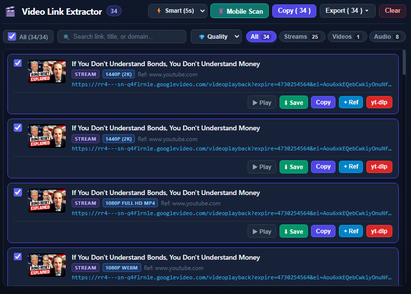

# Video Link Extractor Pro (v5.2)

A powerful browser extension for **Chromium-based browsers** (Chrome, Edge, Brave, Opera, Vivaldi, etc.) that automatically sniffs, captures, previews, and exports streaming video and audio links from any webpage.

---

## 🚀 Key Features

### 🎬 In-Popup Live HLS (`.m3u8`) & Media Player
- Embedded **Hls.js engine** enables native playback of master `.m3u8` streams directly inside the Chrome popup on Windows & Linux without external player software.
- Full video controls with audio/video stream testing.

### 🔍 Real-Time Search & Category Filters
- **Filter Pills**: Instant switching between `All`, `🎬 Streams` (HLS/DASH), `🎥 Videos` (MP4/WebM), `🎵 Audio` (MP3/AAC/M4A), `⏱ Short`, `💬 Subs`, `🧩 Embeds` and `🔒 DRM`.
- **⏱ Short**: audio and video up to a minute long (or, when the length is unknown, files under 500 KB): UI sounds, previews, ad clips. They are listed here instead of under Videos / Audio, and still under All.
- **⭐ Best only** (off by default, remembered): when a video comes in several qualities, only the best one is ticked, so **Copy (N)** and the exports give one link per video. Qualities are recognised as a master playlist and its quality playlists, YouTube itags of one video, or file names / folders that differ only by a quality (`clip_720p.mp4` / `clip_1080p.mp4`, `/720/clip.mp4`). Boxes you tick or untick yourself stay as you set them; turning it off ticks again what it unticked.
- **Search Bar**: Quickly filter streams by URL text, domain name, or filename.

### ⬇️ 1-Click Direct Browser Download
- Direct media file downloads right from the browser popup with sanitized filename inference (named after the video, keeping the file's own extension: `.webm`, `.flac`, `.srt`, ...).

### 📄 One List per Page
- When the tab moves to another page (a link, the address bar, or an in-page route change; not a `#hash` change), the list starts over for that page.
- The lists of the last 3 pages are kept, so going **Back** (or opening that page again in the tab) brings its list back. **Clear** empties the tab, including those.
- The list survives Chrome stopping the extension's background worker when idle.
- **Live**: while the popup is open, new links appear as they are found and the popup follows the tab to its next page. Cards already shown stay where they are, so a running ▶ Play preview keeps playing.

### 📶 Qualities Inside HLS / DASH Streams
- The one-time manifest check (see DRM below) also reads the qualities a master `.m3u8` or an `.mpd` lists. The card shows the best one (`1080p`) and sorts by it, and a playlist the player loaded on its own gets its resolution too.
- **📶 N tracks** opens one row per quality, audio and subtitle track (`1080p · 30 fps · 4.5 Mb/s`, `Audio · English`, ...). For HLS, each row has **Copy**, **+ Ref** and **+ Name** for that quality's own playlist, in the same formats as the card buttons, using the card's Referer and name. DASH tracks have no URL of their own, so they are listed only.

### 🕒 Length of Each Link
- Cards show how long each stream or file is (`🕒 42:10`), or `🔴 Live` for a stream without an end. The length comes from data the extension already reads once per link: an HLS playlist's segment lengths (a master playlist: those of its first quality), a DASH manifest's stated duration, the header of an MP4 / M4A (when its index is at the start of the file) or WebM file, or YouTube-style `dur=` in the URL.
- A playlist the server answers with only its first 64 KB is read again in full, so long playlists get their real length.

### ⏳ Expiry of Signed Links
- Links that carry an expiry time (`expire=`, `Expires=`, `exp=` as in Akamai tokens, S3 `X-Amz-Date` + `X-Amz-Expires`) show the time left: `⏳ 5 h left`, yellow under an hour, `⌛ Expired` after. Links valid for more than 30 days show nothing.

### 🏷️ A Name per Video
- **+ Name**, **⬇ Save** and the card title use the name the page gives that particular video, when it gives one:
  - structured data (JSON-LD `VideoObject`, ...) naming that exact file, on any page;
  - on pages with several differently named videos: the video's `title` / `aria-label` / `data-title`, its `<figure>` caption, or the text of a link to the file (noise such as "Download", "MP4" or "720p" is dropped).
- Otherwise the name is the page's, worked out as before (structured data, `og:title`, the tab title without the site name, else the file name in the URL). On a page with one video, the page name wins over that video's label.

### 📦 Batch Export Suite
- **yt-dlp Batch (`.txt`)**: A URL list for `yt-dlp -a batch.txt`, with each stream's Referer noted as a `# Referer:` comment above it (yt-dlp reads every other line of a batch file as a URL, so headers cannot go in the file; use the per-card **yt-dlp** button for a full command with headers).
- **VLC / MPV Playlist (`.m3u`)**: Export all captured streams as a standard `#EXTM3U` playlist.
- **Structured JSON (`.json`)**: Full export of detected URLs, referer origins, and metadata.

### ⚡ Multi-Layer Deep Stream Sniffing
1. **Network Sniffer**: Intercepts video/audio headers, manifest formats, and query signatures.
2. **Main World API Hooking**: Intercepts `fetch()`, `XMLHttpRequest` (which also catches dash.js manifests), `Hls.prototype.loadSource`, and `HTMLMediaElement.src`.
3. **Shadow DOM & DOM Observer**: Traverses nested Web Components, `<video>`, `<audio>`, and `<source>` elements.
4. **📱 Mobile Safari UA Fallback**: Automatic/manual isolated probe to uncover direct MP4 sources from mobile-optimized video players.
5. **Frame-Level Referer Resolution**: Pinpoints nested iframe origins for CORS/Hotlink protected streams.
6. **🔒 DRM Detection (Add-on)**: works on any site, video or music. See below.

### 🧩 Add-on Detection Modules
Five extra detection layers on top of the ones above. They only **add** links (and labels on links); everything the layers above find is still found exactly as before. They live in their own files (`addon-page.js` in the page, `addon-content.js` next to `content.js`, `addon-worker.js` loaded at the end of the background worker), and every hook passes straight through to the browser's own function.

| Module | Finds | Card shows |
| :--- | :--- | :--- |
| **1. Playlists by content** | HLS / DASH playlists at URLs that do not say so (`/api/stream?id=7`), served as `text/plain`, `application/octet-stream`, ... It reads at most the first 2 KB of a copy of the response. An extension-less URL the server types as a playlist gets the right label too. | `HLS Stream` / `DASH Stream` (qualities, length, ▶ Play), `🔎 By content` |
| **2. Links & player settings** | Media the page points at without loading it: download links (`<a href="…mp4">`), `og:video` / `og:audio` / `twitter:player:stream` tags (read per OpenGraph group), frames / objects showing a file, and media URLs kept in `data-*` attributes (click-to-play players, JSON configs), in Shadow DOM too. A bare file name without a path is never taken for a link. Up to 150 per frame. | `🔗 On page` |
| **3. Embedded players** | Frames (lazy `data-src` ones too) and `og:video` tags showing a YouTube, Vimeo, Dailymotion, Wistia, Brightcove, JW Player, Streamable, Twitch, Kaltura, Rumble, Odysee, Bilibili, Facebook, TikTok or SoundCloud player. YouTube is listed by its watch URL. | `Vimeo embed`, … in the **🧩 Embeds** tab: Copy / + Ref / + Name / yt-dlp with this page as Referer (what yt-dlp needs), no Play / Save |
| **4. Service-worker requests** | Media a site's service worker fetches (Chrome reports those requests without a tab), through the same filters as the network sniffer, given to the tab showing that site (the one playing sound, else the active one). | `⚙ Service worker` |
| **5. Player buffer** | Streams a video player builds itself with Media Source Extensions: each piece it feeds the browser is traced back to the request it came from, so even fully obfuscated segment URLs become one **🧩 segments** card (⬇ .m3u8 export, ffmpeg). It stays out when the stream is already covered (a playlist on the page, pieces already listed or grouped, Spotify's player). Pieces a player rewrites before feeding them (TS turned into MP4, decrypted) cannot be traced. | `🧪 Player buffer` |

- Page scans (modules 2 and 3) look at the whole page once loaded and each time the popup opens, and otherwise only at what the page adds, in slices of a few milliseconds, so even a huge page that keeps changing stays responsive.
- Links added by a module get the same `URL|Referer|Name` outputs as any other card.

---

## 🔒 DRM Detection

Encrypted streams are listed like any other stream and labelled, so you can tell them apart from ones that download normally. Everything lives in `drm-streams.js` plus small hooks in the other scripts.

| Evidence | How it is found | Shown as |
| :--- | :--- | :--- |
| **Browser DRM playback** (EME) | Hooks `MediaKeySession.generateRequest` / `HTMLMediaElement.setMediaKeys`: key system, robustness level, key IDs (PSSH) | Banner: `🔒 DRM detected on this page` + system chips |
| **DASH / HLS / Smooth manifests** | `ContentProtection`, `#EXT-X-KEY` (FairPlay, Widevine, PlayReady), `ProtectionHeader` | `🔒 DRM` + system + scheme (CENC/CBCS) |
| **Encrypted MP4 files** | `pssh` / `schm` / `tenc` boxes in the file header | `🔒 DRM` + system + scheme |
| **License servers** | POST requests to DRM-vendor / `license` endpoints (only shown once DRM playback is confirmed) | Banner: `license: host` |
| **Extension-less DRM files** | Known CDNs, currently **Spotify** audio (`audio*.scdn.co`, `audio*.spotifycdn.com`, `audio-*spotify*.akamaized.net`), i.e. the full podcast episode next to its 60 s preview clips | `🔒 DRM` |

- Plain HLS `AES-128` (key served openly, downloadable with yt-dlp/ffmpeg) is labelled `🔑 AES-128`, **not** DRM.
- The **🔒 DRM** filter pill lists only streams confirmed as DRM-protected. JSON export includes the details; the yt-dlp batch export adds a `#` comment above DRM entries.
- Manifests the page downloads are analysed passively. For the rest, the popup asks the background worker to **check each listed link once**: it reads the manifest (or the first 64 KB of the file) with the page's own Referer, then stores the result. This only touches URLs the page already requested and only when you open the popup.
- Some streams only expose a URL once playback starts: press play, and they appear in the open popup.

### 🧩 Segmented streams (any site)

Players that fetch a stream as many small numbered pieces (`seg_0001.mp4`, `chunk-12.m4a`, …) would flood the list with one entry per piece. They are **grouped into one card per stream**, e.g. `Audio · 🧩 500 segments`, and the init file (`init.mp4`, `inits/mp4`) is attached to it.

**Raw chunks (`.ts`, `.m4s`, `.m4f`, or extension-less `video/mp2t` pieces) are never listed one by one.** They only feed this grouping: a lone chunk, or a couple of them, adds nothing to the list, and once enough of them form a numbered stream they appear as a single card.

**Generic grouping only happens when all of this holds** (so ordinary videos are never merged):
- at least **3** requests share folder, name pattern and query parameter names,
- exactly **one number** in the name changes, at a steady step,
- the pieces were fetched by the page's player code (fetch / XHR), **not** by a plain `<video>` / `<audio>` tag, so a gallery of `clip1.mp4`, `clip2.mp4`, … stays separate videos.

**Spotify's player** (`video-fa.scdn.co/segments/…`) is recognised exactly, and its manifest gives the real duration, bitrate and resolution: `Audio · 100k AAC · 🧩 500 segments · 33:18` (best audio + best video).

- **⬇ .m3u8** exports a VOD playlist (`#EXT-X-MAP` init + every segment, in order, query strings intact). The `ffmpeg` button copies the command that joins it into one file, and the same command is written as a comment at the top of the playlist:
  `ffmpeg -protocol_whitelist file,http,https,tcp,tls,crypto -allowed_extensions ALL -i "episode.m3u8" -c copy "episode.m4a"`
- **Generic streams:** the range is inferred from the requests the page made (gaps between the first and last piece are filled in when the URLs follow one template; if every piece is signed differently, exactly the requested ones are listed). Durations are unknown, so each piece is assumed to last its step (or 4 s), which the playlist states in a comment. Play through the stream before exporting to capture the whole range.
- Video-only streams have no audio track: join them with the audio stream's file in a second ffmpeg step.
- Spotify needs its manifest, captured when playback starts: press play, then open the popup. Signed URLs expire (about a week).
- If a stream turns out to be encrypted, the card also gets the `🔒 DRM` badge; the extension still does not decrypt anything.

> **Detection and labelling only.** The extension does not decrypt anything, obtain licenses, or bypass DRM. Encrypted files need a DRM-capable player, and a listed link is not a downloadable file.

---

## 🛠️ Supported Formats

- **Adaptive Streams**: `.m3u8` (HLS), `.mpd` (DASH), `.m3u`
- **Video**: `.mp4`, `.webm`, `.mkv`, `.mov`, `.avi`, `.flv`, `.m4v`, `.ogv`, `.wmv`, `.3gp`
- **Audio**: `.mp3`, `.aac`, `.flac`, `.wav`, `.ogg`, `.opus`, `.m4a`

---

## 📥 Installation

1. Clone or download this repository.
2. Open Chrome/Edge and go to `chrome://extensions/`.
3. Toggle **Developer mode** in the top-right corner.
4. Click **Load unpacked** and select this directory.

### 🔄 Updating hls.js (manual)
The popup's ▶ Play engine is the bundled `hls.min.js` (currently **hls.js 1.7.4**). It does not update itself, so replace it by hand every couple of months:

1. Check the latest version: `npm view hls.js version` (or the [hls.js releases](https://github.com/video-dev/hls.js/releases) page, where breaking changes are listed).
2. In an empty folder, download the package: `npm pack hls.js@latest` (npm checks the file's integrity), then extract it: `tar -xzf hls.js-*.tgz`.
3. Copy `package/dist/hls.min.js` over `hls.min.js` in this folder.
4. Reload the extension in `chrome://extensions`, then press **▶ Play** on an HLS (`.m3u8`) stream in the popup to check it still plays.

---

## 🎮 Quick Actions per Stream Card

| Button | Action |
| :--- | :--- |
| **▶ Play** / **⏹ Stop** | Preview live HLS stream or video file right in the popup |
| **⬇ Save** | 1-Click direct browser download |
| **+ Ref** | Copies `URL\|Referer` (ideal for custom batch scripts) |
| **+ Name** | Copies `URL\|Referer\|Name`. The name is the one the page gives that video (see *A Name per Video*), else the page's (structured data, `og:title`, or the tab title without the site name), else the file name in the URL |
| **yt-dlp** | Copies complete `yt-dlp --add-header ... "URL"` command |
| **Copy** | Copies raw media URL |

---

## 📄 License
Open source under MIT license.
