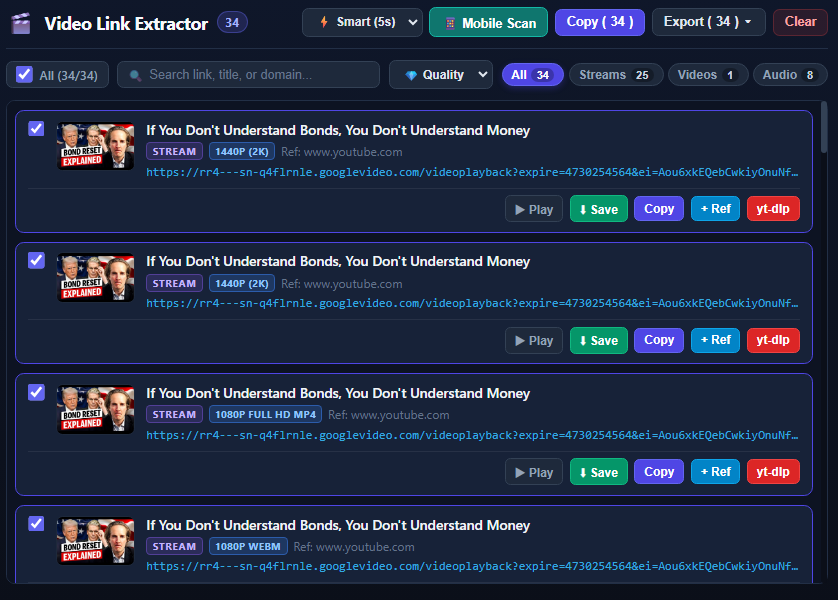

# Video Link Extractor Pro (v5.0)

A powerful browser extension for **Chromium-based browsers** (Chrome, Edge, Brave, Opera, Vivaldi, etc.) that automatically sniffs, captures, previews, and exports streaming video and audio links from any webpage.

---

## 🚀 Key Features

### 🎬 In-Popup Live HLS (`.m3u8`) & Media Player
- Embedded **Hls.js engine** enables native playback of master `.m3u8` streams directly inside the Chrome popup on Windows & Linux without external player software.
- Full video controls with audio/video stream testing.

### 🔍 Real-Time Search & Category Filters
- **Filter Pills**: Instant switching between `All`, `🎬 Streams` (HLS/DASH), `🎥 Videos` (MP4/WebM), and `🎵 Audio` (MP3/AAC/M4A).
- **Search Bar**: Quickly filter streams by URL text, domain name, or filename.

### ⬇️ 1-Click Direct Browser Download
- Direct media file downloads right from the browser popup with sanitized filename inference.

### 📦 Batch Export Suite
- **yt-dlp Batch (`.txt`)**: Generates ready-to-run batch files formatted with per-stream `--add-header "Referer: ..."` for `yt-dlp -a batch.txt`.
- **VLC / MPV Playlist (`.m3u`)**: Export all captured streams as a standard `#EXTM3U` playlist.
- **Structured JSON (`.json`)**: Full export of detected URLs, referer origins, and metadata.

### ⚡ Multi-Layer Deep Stream Sniffing
1. **Network Sniffer**: Intercepts video/audio headers, manifest formats, and query signatures.
2. **Main World API Hooking**: Intercepts `fetch()`, `XMLHttpRequest`, `Hls.prototype.loadSource`, `dashjs.MediaPlayer`, and `HTMLMediaElement.src`.
3. **Shadow DOM & DOM Observer**: Traverses nested Web Components, `<video>`, `<audio>`, and `<source>` elements.
4. **📱 Mobile Safari UA Fallback**: Automatic/manual isolated probe to uncover direct MP4 sources from mobile-optimized video players.
5. **Frame-Level Referer Resolution**: Pinpoints nested iframe origins for CORS/Hotlink protected streams.
6. **🔒 DRM Detection (Add-on)**: works on any site, video or music. See below.

---

## 🔒 DRM Detection

Encrypted streams are listed like any other stream and labelled, so you can tell them apart from ones that download normally. Everything lives in `drm-streams.js` plus small hooks in the other scripts.

| Evidence | How it is found | Shown as |
| :--- | :--- | :--- |
| **Browser DRM playback** (EME) | Hooks `MediaKeySession.generateRequest` / `HTMLMediaElement.setMediaKeys`: key system, robustness level, key IDs (PSSH) | Banner: `🔒 DRM detected on this page` + system chips |
| **DASH / HLS / Smooth manifests** | `ContentProtection`, `#EXT-X-KEY` (FairPlay, Widevine, PlayReady), `ProtectionHeader` | `🔒 DRM` + system + scheme (CENC/CBCS) |
| **Encrypted MP4 files** | `pssh` / `schm` / `tenc` boxes in the file header | `🔒 DRM` + system + scheme |
| **License servers** | POST requests to DRM-vendor / `license` endpoints (only shown once DRM playback is confirmed) | Banner: `license: host` |
| **Extension-less DRM files** | Known CDNs, currently **Spotify** audio (`audio*.scdn.co`, `audio*.spotifycdn.com`, `audio-*spotify*.akamaized.net`), i.e. the full podcast episode next to its 60 s preview clips | `🔒 DRM` |

- Plain HLS `AES-128` (key served openly, downloadable with yt-dlp/ffmpeg) is labelled `🔑 AES-128`, **not** DRM.
- The **🔒 DRM** filter pill lists only streams confirmed as DRM-protected. JSON export includes the details; the yt-dlp batch export adds a `#` comment above DRM entries.
- Manifests the page downloads are analysed passively. For the rest, the popup asks the background worker to **check each listed link once**: it reads the manifest (or the first 64 KB of the file) with the page's own Referer, then stores the result. This only touches URLs the page already requested and only when you open the popup.
- Some streams only expose a URL once playback starts: press play, then reopen the popup.

### 🧩 Segmented streams (any site)

Players that fetch a stream as many small numbered pieces (`seg_0001.mp4`, `chunk-12.m4a`, …) would flood the list with one entry per piece. They are **grouped into one card per stream**, e.g. `Audio · 🧩 500 segments`, and the init file (`init.mp4`, `inits/mp4`) is attached to it.

**Raw chunks (`.ts`, `.m4s`, `.m4f`, or extension-less `video/mp2t` pieces) are never listed one by one.** They only feed this grouping: a lone chunk, or a couple of them, adds nothing to the list, and once enough of them form a numbered stream they appear as a single card.

**Generic grouping only happens when all of this holds** (so ordinary videos are never merged):
- at least **3** requests share folder, name pattern and query parameter names,
- exactly **one number** in the name changes, at a steady step,
- the pieces were fetched by the page's player code (fetch / XHR), **not** by a plain `<video>` / `<audio>` tag, so a gallery of `clip1.mp4`, `clip2.mp4`, … stays separate videos.

**Spotify's player** (`video-fa.scdn.co/segments/…`) is recognised exactly, and its manifest gives the real duration, bitrate and resolution: `Audio · 100k AAC · 🧩 500 segments · 33:18` (best audio + best video).

- **⬇ .m3u8** exports a VOD playlist (`#EXT-X-MAP` init + every segment, in order, query strings intact). The `ffmpeg` button copies the command that joins it into one file, and the same command is written as a comment at the top of the playlist:
  `ffmpeg -protocol_whitelist file,http,https,tcp,tls,crypto -allowed_extensions ALL -i "episode.m3u8" -c copy "episode.m4a"`
- **Generic streams:** the range is inferred from the requests the page made (gaps between the first and last piece are filled in when the URLs follow one template; if every piece is signed differently, exactly the requested ones are listed). Durations are unknown, so each piece is assumed to last its step (or 4 s), which the playlist states in a comment. Play through the stream before exporting to capture the whole range.
- Video-only streams have no audio track: join them with the audio stream's file in a second ffmpeg step.
- Spotify needs its manifest, captured when playback starts: press play, then open the popup. Signed URLs expire (about a week).
- If a stream turns out to be encrypted, the card also gets the `🔒 DRM` badge; the extension still does not decrypt anything.

> **Detection and labelling only.** The extension does not decrypt anything, obtain licenses, or bypass DRM. Encrypted files need a DRM-capable player, and a listed link is not a downloadable file.

---

## 🛠️ Supported Formats

- **Adaptive Streams**: `.m3u8` (HLS), `.mpd` (DASH), `.m3u`
- **Video**: `.mp4`, `.webm`, `.mkv`, `.mov`, `.avi`, `.flv`, `.m4v`, `.ogv`, `.wmv`, `.3gp`
- **Audio**: `.mp3`, `.aac`, `.flac`, `.wav`, `.ogg`, `.opus`, `.m4a`

---

## 📥 Installation

1. Clone or download this repository.
2. Open Chrome/Edge and go to `chrome://extensions/`.
3. Toggle **Developer mode** in the top-right corner.
4. Click **Load unpacked** and select this directory.

---

## 🎮 Quick Actions per Stream Card

| Button | Action |
| :--- | :--- |
| **▶ Play** / **⏹ Stop** | Preview live HLS stream or video file right in the popup |
| **⬇ Save** | 1-Click direct browser download |
| **+ Ref** | Copies `URL\|Referer` (ideal for custom batch scripts) |
| **yt-dlp** | Copies complete `yt-dlp --add-header ... "URL"` command |
| **Copy** | Copies raw media URL |

---

## 📄 License
Open source under MIT license.
